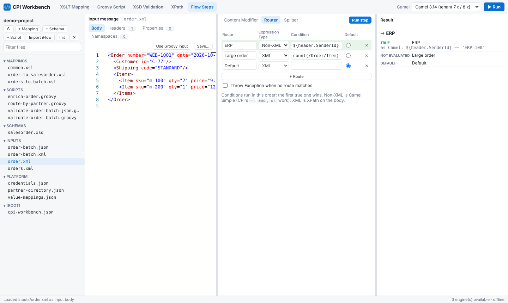

# CPI Workbench

[](https://github.com/jsevenheck/cpi-workbench/actions/workflows/build.yml)
[](https://github.com/jsevenheck/cpi-workbench/releases/latest)
[](LICENSE)

A lean, offline desktop app for testing **SAP Integration Suite (Cloud Integration)** mappings and
scripts locally: enter a message (body, headers, exchange properties), run an **XSLT mapping**, a
**Groovy script** or a **Content Modifier, Filter, Router, Splitter or Gather** and see the resulting body, headers, properties and log entries immediately,
without deploy → trace → monitor round trips.

The goal is to behave like the real CPI step, not like a generic XSLT tester or Groovy console.
That behaviour follows SAP's documentation, SAP's published interfaces and Saxon's and Camel's code;
it has not been checked against a tenant yet ([Fidelity](docs/fidelity.md)).

**XSLT Mapping**

* **Same engine family:** Saxon-HE **9.9** (the release line CPI runs, as Saxon-EE 9.9) or Saxon-HE 12.
* **CPI parameter binding:** every global `xsl:param` gets the header or exchange property with
  the same name, passed as Java objects the way Camel's XSLT component does (typed values work).
* **`$exchange` + `hci:setHeader` / `hci:setProperty`** (namespace `http://sap.com/it/`) change the
  output message, as in CPI.
* Includes/imports resolve inside the project folder like iFlow resources; nothing leaves the machine.

**Groovy Script**

* **Same Groovy versions as CPI:** Groovy **2.4.21** for script step 1.x and **4.0.29** for 2.x, on Java 17.
* **`Message` backed by a real Apache Camel exchange** (Camel 2.24 / 3.14), so `getBody(String)`,
  `getBody(Reader)`, `getHeader(name, Integer)` and case-insensitive header names behave like CPI.
* `messageLogFactory` with MPL properties, custom header properties and attachments;
  `ITApiFactory` with **Secure Store**, **Value Mapping**, **Partner Directory**, **Keystore** and
  **number range** mocks fed from the project's `platform/` folder, following SAP's published API interfaces.
* Compile and runtime errors point to the script line; `println` output is captured.
* Groovy 1.x → 2.x differences surface for real (e.g. `groovy.util.XmlSlurper` no longer exists in Groovy 4).

**Flow Steps**

* **Content Modifier**, **Filter**, **Router**, **General / Iterating Splitter** and **Gather** with their
  CPI settings, on the tenant's Camel line (3.14 or 2.24): Camel Simple with CPI's spellings (`=`, `and`,
  `${property.x}`), XPath 3.1 on Saxon, split messages with `CamelSplit*` information, gathered again in
  SAP's multi-mapping format.
* **Import iFlow** lists an exported iFlow's scripts, mappings and these steps and opens them with
  their settings.

Everything runs locally; the app never connects to a tenant.




## Install

Download the installer for Windows, macOS (Apple Silicon) or Linux from the
**[latest release](https://github.com/jsevenheck/cpi-workbench/releases/latest)**. It brings its own
engines and Java runtime. The installers are not code-signed yet; [Installing](docs/install.md)
shows how to get past the first-start warning.

## Quick start

1. Open a folder as project and press **Init**, or open [`examples/demo-project`](examples/demo-project/README.md).
2. Open a mapping or script, enter the input message and press **Ctrl+Enter**.

Test cases also run on the command line with the engine jars from the release (Java 17+), or from
source:

```sh
mvn -f engine/pom.xml package -DskipTests
java -jar engine/xml-he99/target/cpiwb-xml-he99.jar test testdata/regression-project/tests
java -jar engine/groovy-v1/target/cpiwb-groovy-v1.jar test testdata/regression-project/tests
```

## Documentation

The [documentation index](docs/README.md) lists everything. The most used pages:

* [Installing](docs/install.md)
* [User guide](docs/user-guide.md): desktop app, command line, browser mode
* [Test cases and platform data](docs/test-cases.md)
* [Fidelity](docs/fidelity.md): what matches CPI and what is still to verify
* [Implementation status](docs/status.md)
* [Building](docs/building.md)
* [Plan and research ledger](docs/plan.md)

## Contributing

Issues and pull requests are welcome; see [CONTRIBUTING](CONTRIBUTING.md) and the
[changelog](CHANGELOG.md). Report security problems privately ([SECURITY](SECURITY.md)).

## Licence

CPI Workbench is licensed under the [Apache License 2.0](LICENSE). SAP, SAP Integration Suite and
Cloud Integration are trademarks of SAP SE; this project is not affiliated with or endorsed by SAP.

### Licences of bundled components

Saxon-HE: MPL-2.0 · Groovy, Apache Camel: Apache-2.0 · Tauri, Monaco: MIT/Apache-2.0 ·
OpenJDK runtime and GraalVM Native Image runtime: GPLv2 with Classpath Exception · JavaBeans
Activation (javax.activation): CDDL/GPLv2+CE · test corpus from pizug/cpi-groovy-examples: MIT.
The licence texts and notices are in [`licenses/`](licenses/README.md); the installers and jars
include them.
No SAP code or jars are included; the `com.sap.*` classes in `engine/groovy` are clean-room
simulations written from SAP's public documentation.
